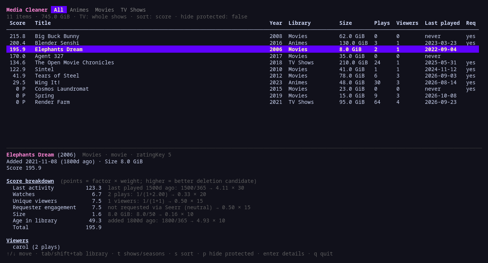
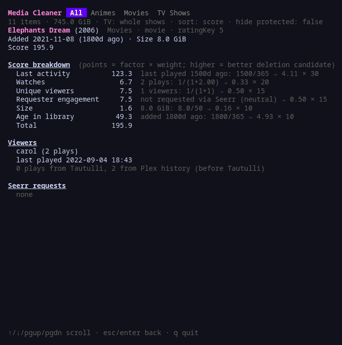
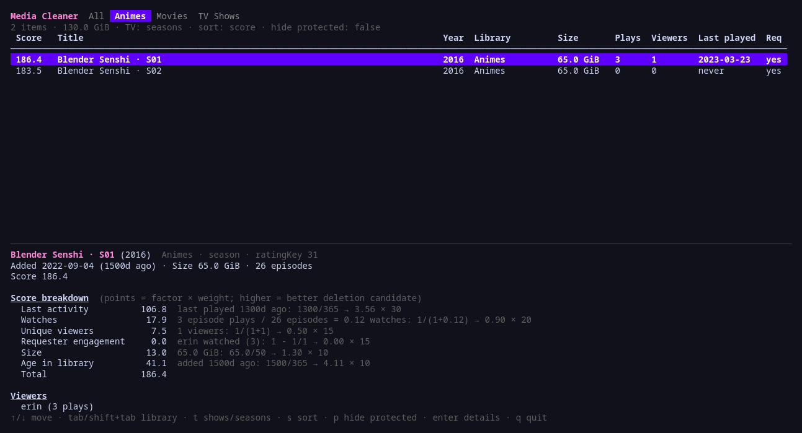

# media-server-cleaner

A terminal UI that scores every **movie, show and season** on a Plex server as a candidate for deletion, using watch stats from **Tautulli** (with **Plex history** as fallback) and request data from **Seerr** (formerly Overseerr).

It never deletes anything. It shows a ranked list and, for each item, exactly how its score was computed so you can decide what to remove.



## Features

- Scores whole movies, whole shows, or individual seasons (toggle with `t`).
- Combines watch history from Tautulli and Plex's own history (for the period before Tautulli was installed), without double counting.
- Checks whether the people who requested something in Seerr actually watched it.
- Protects recently added, played or requested items with a grace period.
- Full per-factor score breakdown for every item.
- Per-library tabs (Movies, TV Shows, Animes, ...).

## Install

Requires Go 1.26+.

```sh
git clone <this repo> && cd media-server-cleaner
go build -o media-server-cleaner .
cp .env.example .env   # then fill in tokens / API keys
./media-server-cleaner
```

The `.env` file is read from the current directory. Real environment variables take precedence over it.

## Configuration

### Services

| Variable | Required | Description |
|---|---|---|
| `PLEX_URL` | yes | Plex server URL, e.g. `https://plex.example.com` |
| `PLEX_TOKEN` | yes | Plex token ([how to find it](https://support.plex.tv/articles/204059436-finding-an-authentication-token-x-plex-token/)). Use the server owner's token so history for all users is visible. |
| `TAUTULLI_URL` | no | Tautulli URL |
| `TAUTULLI_API_KEY` | no | Tautulli → Settings → Web Interface → API key |
| `SEERR_URL` | no | Seerr / Overseerr URL |
| `SEERR_API_KEY` | no | Seerr → Settings → General → API Key |
| `LIBRARIES` | no | Comma-separated Plex library names to include, e.g. `Movies,TV Shows,Animes`. Default: all movie and show libraries. |

If Tautulli or Seerr is missing or unreachable, the tool still runs and shows a warning in the status bar.

### Scoring

Higher score = better deletion candidate. Each factor produces a value which is multiplied by its weight; the score is the sum of all factors.

| Variable | Default | Factor | Value |
|---|---|---|---|
| `WEIGHT_LAST_ACTIVITY` | `30` | Last activity | days since last play (or since added if never played) ÷ `STALE_DAYS` — uncapped |
| `WEIGHT_WATCHES` | `20` | Watches | `1 / (1 + watches)`; for shows/seasons, watches = episode plays ÷ episode count |
| `WEIGHT_VIEWERS` | `15` | Unique viewers | `1 / (1 + viewers)` |
| `WEIGHT_REQUEST` | `15` | Requester engagement | `1 − requesters who watched ÷ requesters`; `0.5` if not requested |
| `WEIGHT_SIZE` | `10` | Size | size in GiB ÷ `SIZE_REF_GB` — uncapped |
| `WEIGHT_AGE` | `10` | Age in library | days since added ÷ `STALE_DAYS` — uncapped |
| `STALE_DAYS` | `365` | | Number of days worth 1× the weight for time-based factors |
| `SIZE_REF_GB` | `50` | | Size worth 1× the size weight |
| `GRACE_DAYS` | `30` | | Items added, played or requested within this many days are **protected** (score forced to 0, shown as `0 P`) |

Example: a movie never played, added 2 years ago, 100 GiB, not requested:

```
Last activity        60.0   730/365 → 2.00 × 30
Watches              20.0   1/(1+0) → 1.00 × 20
Unique viewers       15.0   1/(1+0) → 1.00 × 15
Requester engagement  7.5   not requested → 0.50 × 15
Size                 20.0   100/50  → 2.00 × 10
Age in library       20.0   730/365 → 2.00 × 10
Total               142.5
```

## Controls

| Key | Action |
|---|---|
| `↑` / `↓` (`k` / `j`) | Move selection |
| `pgup` / `pgdn` | Page up / down |
| `tab` / `shift+tab` | Next / previous library tab |
| `t` | Toggle TV granularity: whole shows ↔ seasons |
| `s` | Cycle sort: score → size → last played → title |
| `p` | Hide / show protected items |
| `enter` | Open / close full-screen details |
| `esc` | Close details |
| `q` / `ctrl+c` | Quit |

### Detail view

`enter` opens the full breakdown for the selected item: every factor with its points and formula, the viewers with their play counts, how many plays came from Tautulli vs. Plex history, and the Seerr requests.



### Season mode

Press `t` to score each season on its own, which is useful to find long-running shows where only the first seasons get watched.



## How data is combined

- **Plex**: library items (movies, shows, seasons), added date, file sizes (summed over episodes for shows and seasons), TMDB/TVDB IDs.
- **Tautulli**: full play history. Episode plays count toward both the show and the season.
- **Plex history**: used only for plays *before* the oldest Tautulli entry, to cover the period before Tautulli was installed. Plex account names are mapped to usernames through Tautulli's user list so the same person is counted once. Plex only records an item as viewed at ~90% progress, so plays from that period may be under-counted.
- **Seerr**: requests (declined requests are ignored), matched to Plex by rating key, then by TMDB/TVDB ID. TV requests apply to the requested seasons.
